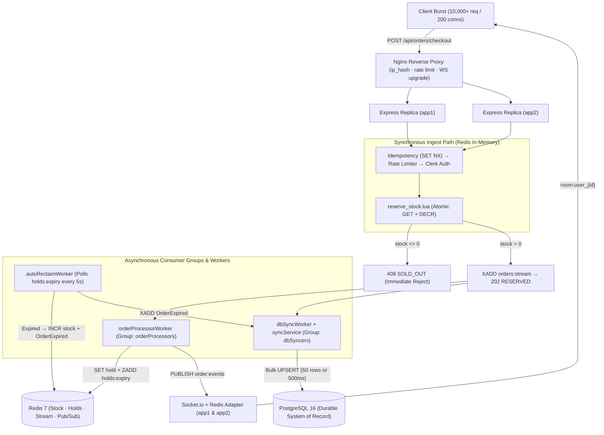
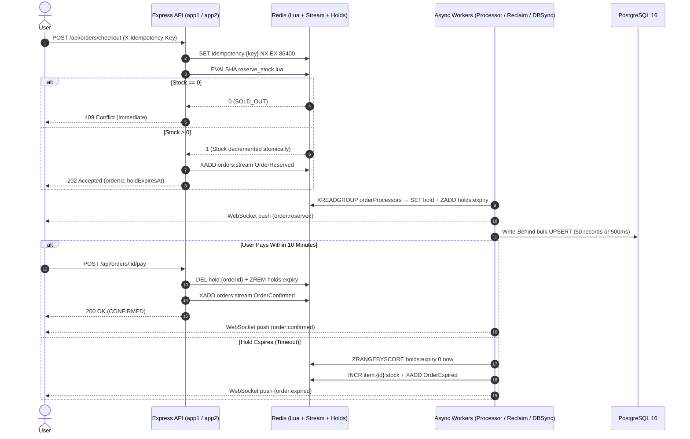

# FlashDrop ⚡

> High-concurrency flash sale & ticket booking engine — built to handle the exact problem Ticketmaster, BookMyShow, and Nike SNKRS face: **10,000+ users attempting to buy 100 items at the exact same second.**

FlashDrop eliminates database row-locking bottlenecks by decoupling the ingest layer, using **Redis atomic Lua scripts** for sub-millisecond stock reservation, **Redis Streams** as an ordered event sequencer, and persisting data asynchronously via a **Write-Behind buffering pipeline** with real-time **WebSocket push notifications**.

---

## Architecture



---

## Order Lifecycle & Race Prevention



---

## Why Not Just Use a Database?

| Architecture | Race Conditions | DB Load at 10k req/s | Inventory on Crash |
|---|---|---|---|
| Traditional SQL (`SELECT FOR UPDATE`) | ❌ Row lock contention | ❌ Crashes | ✅ Consistent |
| Redis atomic only (sync DB write) | ✅ Fixed | ❌ Still crashes | ❌ Ghost items |
| **FlashDrop (Redis Lua + Streams + Write-Behind)** | ✅ Fixed | ✅ < 10 connections | ✅ Stream PEL replay |

---

## Benchmark Results

> Seeded item with `totalStock = 100`, fired 10,000 unique requests in burst with 200 concurrent connections (`autocannon` with `idReplacement`).

| Metric | Result |
|---|---|
| Ingest throughput | **2,500 req/s** |
| Latency p50 | **55 ms** |
| Latency p95 | **72 ms** |
| Latency p99 | **791 ms** |
| Orders created | **100 / 100** |
| Oversold units | **0** |
| 5xx errors | **0** |
| DB connections under load | < 10 |

> Run `npm test`, `npm run benchmark`, then `npm run verify` to reproduce these results.

---

## Tech Stack

| Layer | Technology |
|---|---|
| API | Node.js + Express |
| Auth | Clerk (`@clerk/express`) |
| API Docs | Scalar — interactive OpenAPI 3.1 playground at `/docs` |
| In-Memory Core | Redis 7 — Streams + Lua scripts + Sorted Sets + Pub/Sub |
| Real-Time | Socket.io + `@socket.io/redis-adapter` |
| Database | PostgreSQL 16 |
| Validation | Zod |
| Load Testing | Autocannon |
| Infrastructure | Docker Compose (8 services) + Nginx |

---

## Quick Start

**Prerequisites:** Docker + Docker Compose

```bash
# 1. Clone
git clone https://github.com/georgejosephcodes/FlashDrop.git
cd FlashDrop

# 2. Configure
cp .env.example .env
# Edit .env — set SKIP_AUTH=true for local dev (no Clerk account needed)
# Create .env.local with localhost:5433 / localhost:6380 for running host scripts

# 3. Boot everything (Nginx, 2 API replicas, 3 workers, Redis, Postgres)
docker compose up --build
```

**Visit `http://localhost:8080/docs`** — Scalar API playground loads automatically.

---

## Running the Benchmark

```bash
# 1. Make sure docker compose is running (with RATE_LIMIT_PER_SECOND=10000 in .env)

# 2. Seed a benchmark item (stock = 100)
curl -s -X POST http://localhost:8080/api/items \
  -H "Content-Type: application/json" \
  -d '{"title":"Benchmark Drop","priceCents":100,"totalStock":100,"saleStartAt":"2026-01-01T00:00:00Z"}' \
  | jq -r .id

# 3. Run the load test (replace <uuid> with the ID from step 2)
ITEM_ID=<uuid> npm run benchmark

# 4. Verify zero overselling & DB conservation
ITEM_ID=<uuid> TOTAL_STOCK=100 npm run verify
```

---

## API Reference

| Method | Endpoint | Auth | Description |
|---|---|---|---|
| `GET` | `/api/items` | None | List all items |
| `POST` | `/api/items` | None | Create + seed item (admin) |
| `POST` | `/api/orders/checkout` | Clerk JWT | Atomic reserve — returns 202 or 409 |
| `POST` | `/api/orders/:id/pay` | Clerk JWT | Confirm payment, clear hold |
| `GET` | `/api/metrics` | None | Live stock, holds, stream length |
| `GET` | `/health` | None | Instance health check |

**Required header on checkout:**
```
X-Idempotency-Key: <client-generated-uuid>
```

**WebSocket events** (Socket.io):
```js
socket.emit('subscribe', { userId: 'usr_xxx' })
// Receives:
// order:reserved  → { orderId, expiresAt }
// order:confirmed → { orderId, confirmedAt }
// order:expired   → { orderId, reason }
```

---

## Key Engineering Decisions

**1. Sorted set for expiry, not keyspace notifications**
Redis keyspace notifications drop events on reconnect. Polling `holds:expiry` (a sorted set scored by expiry timestamp) is reliable — entries stay until explicitly removed.

**2. Write-Behind threshold**
Flush on 50 records **or** 500ms elapsed — whichever comes first. Prevents both latency spikes (too infrequent) and DB hammer (too frequent).

**3. Two consumer groups on the same stream**
`orderProcessors` (creates holds, pushes WebSocket) and `dbSyncers` (persists to Postgres) are independent — a slow DB never blocks real-time push.

**4. `ON CONFLICT (id) DO UPDATE` with batch deduplication**
Makes every DB sync flush idempotent across `OrderReserved`, `OrderConfirmed`, and `OrderExpired` transitions without duplicate key failures.

---

## Project Structure

```
src/
├── server.js                    ← Entry point
├── config/                      ← env, redis, db singletons
├── routes/                      ← checkout, payment, items, metrics
├── controllers/                 ← checkout, payment, items
├── middleware/                  ← auth (Clerk), idempotency, rate limiter
├── services/                    ← redisService, streamService, syncService, socketService
├── workers/                     ← orderProcessor, autoReclaim, dbSync
├── scripts/reserve_stock.lua    ← Atomic stock decrement
└── docs/                        ← openapi.json, scalar.js
benchmark/
├── load-test.js                 ← Autocannon 10k requests
└── verify-integrity.js          ← Zero-oversell assertion
sql/init.sql                     ← PostgreSQL schema
nginx/nginx.conf                 ← Load balancer config
```

---

*Built by George Joseph — SDE Intern Project, 2026*
